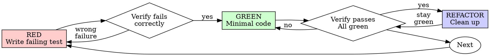

# Test-Driven Development (TDD)

## Overview

TDD is a method for specifying behavior before implementing it: write the test first, watch it fail for the right reason, write minimal code to pass.

**Core principle:** A test you have watched fail for the expected reason is evidence that it can catch that break.

TDD is a strong way to protect behavior, not a gate. Choose it when the behavior can be specified before implementation and the regression risk justifies it. When implementation already exists, keep correct code and add behavior tests instead of deleting work because of its order.

## When to Use

A good fit:
- New or changed observable behavior with a clear contract
- A bug you can reproduce as a failing test
- A refactor already covered by tests
- Risky logic where a wrong branch, boundary, or side effect is plausible

May fit less well:
- Throwaway prototypes, generated code, or configuration-only changes
- Implementation-first work where correct code already exists
- Changes whose risk is better covered by integration, end-to-end, or manual checks

Choose based on the behavior being changed and the regression risk. Test selection does not depend on function count: trivial getters, constants, and pure forwarding do not each need a test. If the human or the calling context requires TDD, follow that requirement; otherwise this skill supplies the method, not a mandate.

Thinking "TDD does not fit here"? Say why, and name the verification that covers the behavior instead.

## The Iron Law

```
WHEN YOU CHOOSE TDD:
NO NEW BEHAVIOR WITHOUT A TEST THAT FIRST FAILS FOR THE RIGHT REASON
```

Wrote the implementation before the test? Keep it if it is correct. Add the behavior test, confirm it fails when the behavior is broken (temporarily revert or mutate the implementation), then restore and confirm it passes. Do not delete working code merely because it was written first.

## Red-Green-Refactor



### RED - Write Failing Test

Write one minimal test showing what should happen.

<Good>
```typescript
test('retries failed operations 3 times', async () => {
  let attempts = 0;
  const operation = () => {
    attempts++;
    if (attempts < 3) throw new Error('fail');
    return 'success';
  };

  const result = await retryOperation(operation);

  expect(result).toBe('success');
  expect(attempts).toBe(3);
});
```
Clear name, tests real behavior, one thing
</Good>

<Bad>
```typescript
test('retry works', async () => {
  const mock = jest.fn()
    .mockRejectedValueOnce(new Error())
    .mockRejectedValueOnce(new Error())
    .mockResolvedValueOnce('success');
  await retryOperation(mock);
  expect(mock).toHaveBeenCalledTimes(3);
});
```
Vague name, tests mock not code
</Bad>

**Requirements:**
- One behavior
- Clear name
- Real code (no mocks unless unavoidable)

### Verify RED - Watch It Fail

Do not skip this when you are using TDD.

```bash
npm test path/to/test.test.ts
```

Confirm:
- Test fails (not errors)
- Failure message is expected
- Fails because feature missing (not typos)

**Test passes?** You're testing existing behavior, or the test does not exercise the change. Fix the test.

**Test errors?** Fix error, re-run until it fails correctly.

### GREEN - Minimal Code

Write simplest code to pass the test.

<Good>
```typescript
async function retryOperation<T>(fn: () => Promise<T>): Promise<T> {
  for (let i = 0; i < 3; i++) {
    try {
      return await fn();
    } catch (e) {
      if (i === 2) throw e;
    }
  }
  throw new Error('unreachable');
}
```
Just enough to pass
</Good>

<Bad>
```typescript
async function retryOperation<T>(
  fn: () => Promise<T>,
  options?: {
    maxRetries?: number;
    backoff?: 'linear' | 'exponential';
    onRetry?: (attempt: number) => void;
  }
): Promise<T> {
  // YAGNI
}
```
Over-engineered
</Bad>

Don't add features, refactor other code, or "improve" beyond the test.

### Verify GREEN - Watch It Pass

Run the test and the surrounding suite.

```bash
npm test path/to/test.test.ts
```

Confirm:
- Test passes
- Other tests still pass
- Output pristine (no errors, warnings)

**Test fails?** Fix code, not test.

**Other tests fail?** Fix now.

### REFACTOR - Clean Up

After green only:
- Remove duplication
- Improve names
- Extract helpers

Keep tests green. Don't add behavior.

### Repeat

Next failing test for next feature.

## Good Tests

| Quality | Good | Bad |
|---------|------|-----|
| **Minimal** | One thing. "and" in name? Split it. | `test('validates email and domain and whitespace')` |
| **Clear** | Name describes behavior | `test('test1')` |
| **Shows intent** | Demonstrates desired API | Obscures what code should do |

When writing or changing any test, read [writing-good-tests.md](writing-good-tests.md) for the rules that keep tests honest:
- Name the production change that would make the test fail — before writing it
- Assert on real behavior, never on mock behavior
- Keep test-only code in test utilities, out of production classes
- Understand a dependency's side effects before mocking it

## Common Rationalizations

| Excuse | Reality |
|--------|---------|
| "Too simple to test" | Simple code can break. Test the boundary that carries risk, not every helper. |
| "I'll test after" | Tests added after are weaker evidence unless you confirm they can fail. That is allowed when implementation already exists; validate the test against a broken version when practical. |
| "Tests after achieve the same goals (spirit not ritual)" | Tests-after can protect behavior, but they have not shown they can fail. Confirm with a temporary revert or a mutation when practical. |
| "Already manually tested" | Manual testing is ad-hoc: no record of what you covered, no way to re-run it when the code changes, easy to forget cases under pressure. "Worked when I tried it" ≠ comprehensive. Automated tests run the same way every time. |
| "Deleting X hours is wasteful" | You do not need to delete it. Keep correct working code and add behavior tests that demonstrate the break they catch. |
| "Keep as reference, write tests first" | Keeping correct code is fine. The risk is unverified code, not the order itself. Add tests that can fail for the right reason. |
| "Need to explore first" | Explore, then decide whether the behavior is test-first or implementation-first with a later behavior test. |
| "Test hard = design unclear" | Listen to test. Hard to test = hard to use. |
| "TDD will slow me down" | TDD can be slower up front and cheaper than debugging production. Use it where behavior and risk justify it. |
| "Manual test faster" | Manual doesn't prove edge cases. You'll re-test every change. |
| "Existing code has no tests" | Add tests for the behavior you change; you do not need to retrofit every function. |

## Red Flags - Check the Test or the Evidence

- Test passes immediately when you expected it to fail
- Can't explain why the test would fail
- Test asserts implementation internals or mock behavior instead of the real behavior
- Test added after implementation and never shown to fail
- "I already manually tested it" used as the only evidence
- Rationalizing away a behavior check the change needs
- "This is different because..." used to avoid stating what verifies it

These are prompts to inspect the test or evidence, not proof that code must be deleted. A test added after implementation is acceptable when you confirm it catches the intended break; it is not the same evidence as a test you watched fail first.

## Example: Bug Fix

**Bug:** Empty email accepted

**RED**
```typescript
test('rejects empty email', async () => {
  const result = await submitForm({ email: '' });
  expect(result.error).toBe('Email required');
});
```

**Verify RED**
```bash
$ npm test
FAIL: expected 'Email required', got undefined
```

**GREEN**
```typescript
function submitForm(data: FormData) {
  if (!data.email?.trim()) {
    return { error: 'Email required' };
  }
  // ...
}
```

**Verify GREEN**
```bash
$ npm test
PASS
```

**REFACTOR**
Extract validation for multiple fields if needed.

## Verification Checklist

Before marking work complete, when TDD was chosen:

- [ ] The behavior changed by this work has a test, or another check covers it and the reason is recorded
- [ ] Each test names the break it catches
- [ ] Tests expected to fail did fail for the expected reason (feature missing, not a typo)
- [ ] Wrote minimal code to make each test pass
- [ ] All relevant tests pass
- [ ] Output pristine (no errors, warnings)
- [ ] Tests use real code (mocks only if unavoidable)
- [ ] Edge cases and errors covered in proportion to risk

When implementation came first, replace the fail-first items with evidence that each added test catches the intended break. A missed box does not by itself mean deleting working code; it means the evidence for that behavior is not yet sufficient.

## When Stuck

| Problem | Solution |
|---------|----------|
| Don't know how to test | Write wished-for API. Write assertion first. Ask your human partner. |
| Test too complicated | Design too complicated. Simplify interface. |
| Must mock everything | Code too coupled. Use dependency injection. |
| Test setup huge | Extract helpers. Still complex? Simplify design. |

## Debugging Integration

Bug found? Reproduce it with a failing test when practical, or record another evidence-based reproduction. Confirm the test fails for the right reason, then fix. The regression test proves the fix and prevents recurrence.

Every bug fix needs regression evidence. TDD is one way to produce it, not the only acceptable order.

## Final Rule

```
Tests protect behavior and regression risk.
When TDD is chosen, a test that failed for the right reason
before the change is the strongest evidence.
Correct implementation written first is kept, not deleted.
```

If the human or the calling context requires TDD, follow it. Otherwise choose the method that gives the behavior the evidence its risk requires.
